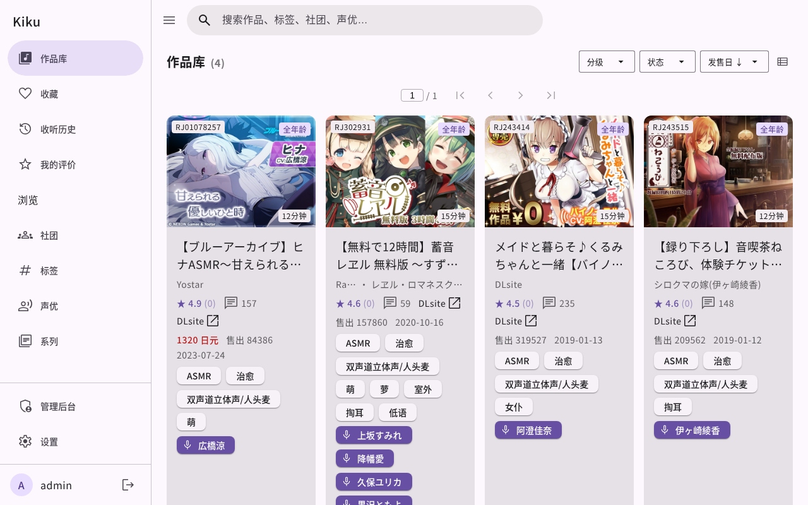
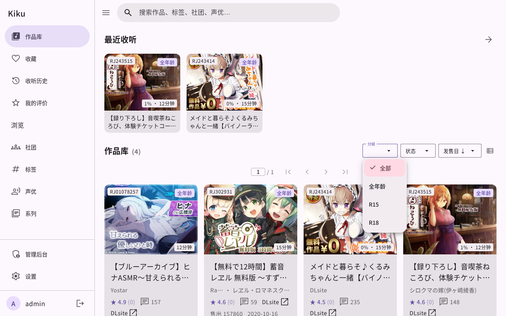
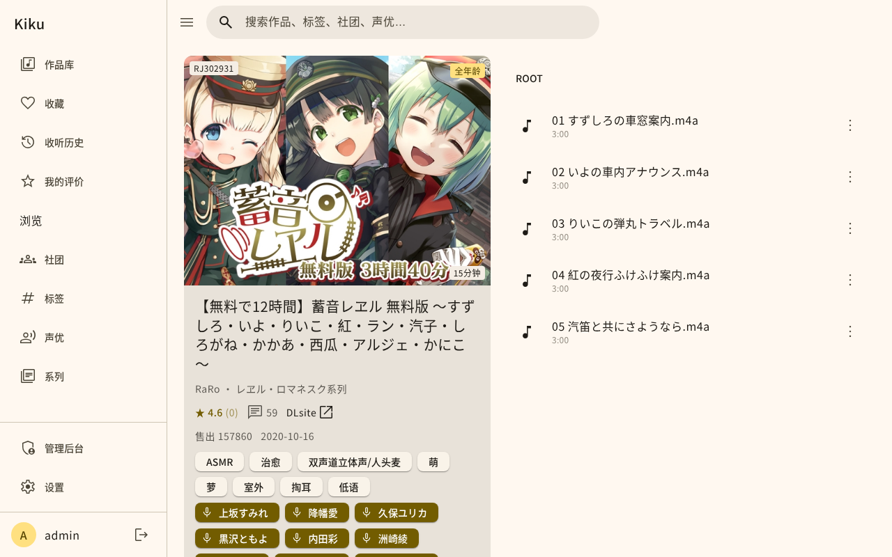
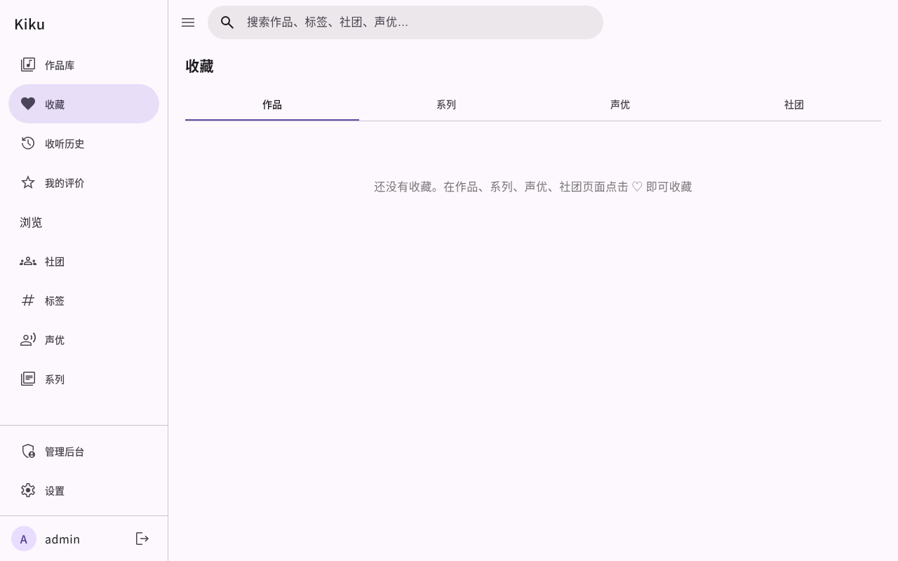

# Browsing and Personal Data

This chapter covers everyday use: finding works, organizing favourites, ratings and reviews, and the progress and history kiku keeps track of.

## Library

The library is the main browsing view, available as a grid or a list (switchable):

With "Recent listens" enabled, a strip of recently played works appears at the top of the library home.

## Search and Filters

- **Keyword search**: the global search bar at the top matches works by keyword; it also accepts field syntax for exact filtering, e.g. `circle:"circle name"`, `tag:"tag"`, `va:"voice actor"`, `series:"series name"` (tapping a circle / tag / … chip on a detail page generates the same query)
- **Field filters**: browse and filter by circle, tag, voice actor or series; combine multiple conditions

Filters are reflected in the address bar, so a filtered view can be bookmarked or shared as a link.

## Sorting

The library can be sorted by:

- Release date (newest first / oldest first)
- RJ code (descending / ascending)
- Random
- Better random

## Browsing Modes

Two pagination styles (switch in [Settings · Library Preferences](settings.md#library-preferences)):

- **Pagination**: jump to any page; page and filter state live in the address bar
- **Infinite scroll**: keep scrolling and more works load automatically

In paginated mode the page size (10 / 20 / 50 / 100, default 20) and the position of the pagination control (top / bottom / both) are configurable.

## Work Detail Page

The detail page shows everything about a work: cover, title, circle, voice actors, tags, series, rating, release date, age rating and more, with the work's file tree below. Manual works (see [Dashboard · Work Layouts](library.md#work-layouts)) have no DLsite page and show no DLsite link.

- **Resume**: re-entering a partly-listened work offers to continue from the last position
- **File preview**: preview image and text files (lyrics, readme text, …)
- **Download**: download an individual file
- **File actions**: add to queue, play next, open file, view the loudness curve

## Favourites

Works, series, voice actors and circles can all be favourited; the favourites page lists them by category. Signing in is required.

## Ratings and Reviews

On a work's detail page, give a star rating and write a short review; ratings and reviews are collected under "My Reviews". Signing in is required.

## Read and Unread

Played works are marked as read automatically; works can also be marked read or unread manually.

## Listen History

Play history is listed chronologically; browse and page through it on the listen history page (also linked from the navigation drawer). Each entry shows where playback last stopped. Signing in is required.
