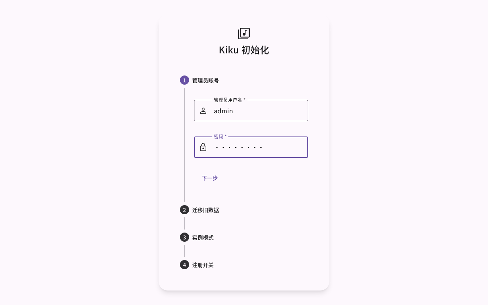
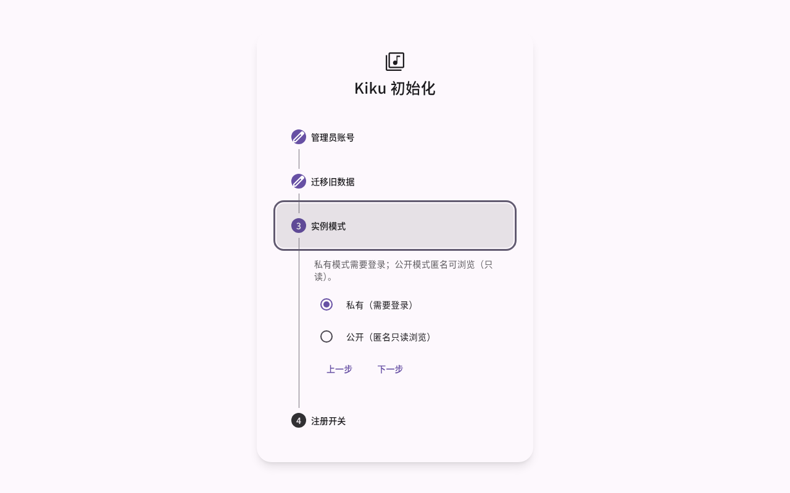

# Installation

This chapter covers deploying kiku and completing the first-time setup: Docker Compose (recommended) or running from source.

## System Requirements

- **Docker deployment (recommended)**: Docker Engine and Docker Compose v2
- **From source**: [Bun](https://bun.sh) 1.x
- Browser: a recent version of Chrome / Edge / Firefox / Safari
- Network: the server must be able to reach DLsite, used for scraping work metadata and covers

## Docker Compose Deployment (Recommended)

No need to clone the repository: create a new directory (e.g. `kiku`) to hold config and data, and create a `compose.yml` inside it with the following content:

```yaml
services:
  kiku:
    image: ghcr.io/sion10032/kiku:latest
    restart: always
    ports:
      - "8888:8888"
    environment:
      HOST: 0.0.0.0
      PORT: 8888
      PUID: ${PUID:-1000}
      PGID: ${PGID:-1000}
    volumes:
      - ./data:/app/data
      - ${MEDIA_DIR:-./data/library}:/media:ro
```

Then run this in that directory:

```bash
docker compose up -d
```

This uses the prebuilt image `ghcr.io/sion10032/kiku:latest`, listening on port `8888`. Once started, open `http://<host>:8888` in a browser.

### Environment Variables

Adjust these in `compose.yml` or a `.env` file next to it:

| Variable | Default | Description |
| --- | --- | --- |
| `HOST` | `0.0.0.0` | Address the server listens on |
| `PORT` | `8888` | Port the server listens on |
| `PUID` | `1000` | User uid owning the data directory |
| `PGID` | `1000` | Group gid owning the data directory |
| `MEDIA_DIR` | `./data/library` | Media library root on the host, mounted read-only at `/media` inside the container |

Set `PUID` / `PGID` to the host user's uid / gid so the data directory ownership matches.

### Data Directory

| Host path | Container path | Contents |
| --- | --- | --- |
| `./data` | `/app/data` | `config.json` (generated automatically on first start) and the `sqlite/` database |
| `${MEDIA_DIR}` (default `./data/library`) | `/media` (read-only) | Voice-work files |

The media directory is mounted **read-only**: kiku never writes to media files. Scans, metadata, playback progress and everything else live in `./data` — backing up that directory backs up the whole server.

On first start `config.json` is generated automatically; no manual preparation is needed.

If you previously ran the backend from a development checkout, existing data can be carried over to the Docker data directory:

```bash
cp -a kiku-backend/data/. ./data/
```

## Running from Source

Useful for development, or when Docker is not an option:

```bash
# 1. Start the backend (listens on 8888)
cd kiku-backend
bun install
bun run dev

# 2. In another terminal, start the frontend (listens on 5173)
cd kiku-frontend
bun install
bun run dev
```

Then open `http://localhost:5173`.

Alternatively, clone the repository (the frontend and backend live in it as submodules) and build the Docker image from source, instead of using the prebuilt image:

```bash
git submodule update --init
docker compose up -d --build
```

This uses the `compose.yml` shipped in the repository.

## Setup Wizard

On first visit the page walks through instance setup (4 steps):



### Step 1: Admin Account

Choose the admin username and password. The admin can open the dashboard for scanning, metadata management and more.

### Step 2: Migrate Old Data

The wizard automatically checks the `old-data` directory for data from an older kikoeru install and shows what it found: works, users (passwords included), reviews, play history (migrated as read marks) and covers.

- Found old data and want it migrated: leave the switch on and it will be migrated when setup finishes
- Fresh install: skip it (skipping means it cannot be auto-migrated later)

### Step 3: Instance Mode



- **Private (login required)**: every visitor must sign in — best for personal or small-group use
- **Public (anonymous read-only browsing)**: anonymous visitors can browse the library; favourites, ratings and history require signing in

You can change this later in the dashboard's server settings.

### Step 4: Registration

Decide whether visitors can register their own accounts. New registrations get regular permissions, which the admin can adjust at any time.

When everything looks right, click "Finish Setup".

## Migrating from kikoeru

If kikoeru (kikoeru-express + kikoeru-quasar) or its Number178 fork (kikoeru number17) was used previously, the setup wizard can migrate the old data automatically:

1. Mount or copy the old data directory (containing `sqlite/db.sqlite3` and `covers/`) as the `old-data` directory inside the container. With Docker Compose, add this to the volume list in `compose.yml`:

   ```yaml
   volumes:
     - ./old-data:/app/old-data:ro
   ```

2. Restart the container and open the page — the setup wizard will detect the old data
3. Leave the "Migrate old data" switch on and click "Finish Setup"

After migration, open the dashboard and point the root folders at the actual paths in this environment (e.g. `/media/...`), then run a scan.

## Upgrading

```bash
docker compose pull        # fetch the new image
docker compose up -d
```

The `./data` volume is left untouched, so configuration, databases and backup snapshots all survive the upgrade. Copy `./data` somewhere safe beforehand as a backup.

## Troubleshooting

**The container exits right after starting; the log shows `EACCES: permission denied, open '/app/data/config.json'`**

The data directory's owner does not match `PUID`. The container attempts to correct the directory's ownership automatically on start; if the error persists, check that the owner and mount permissions of `./data` on the host match `PUID` / `PGID`.

**The page won't load**

Check the port mapping (default `8888:8888`) and any firewall; service health can be verified via `GET /api/health` (reachable without login even in private mode).
