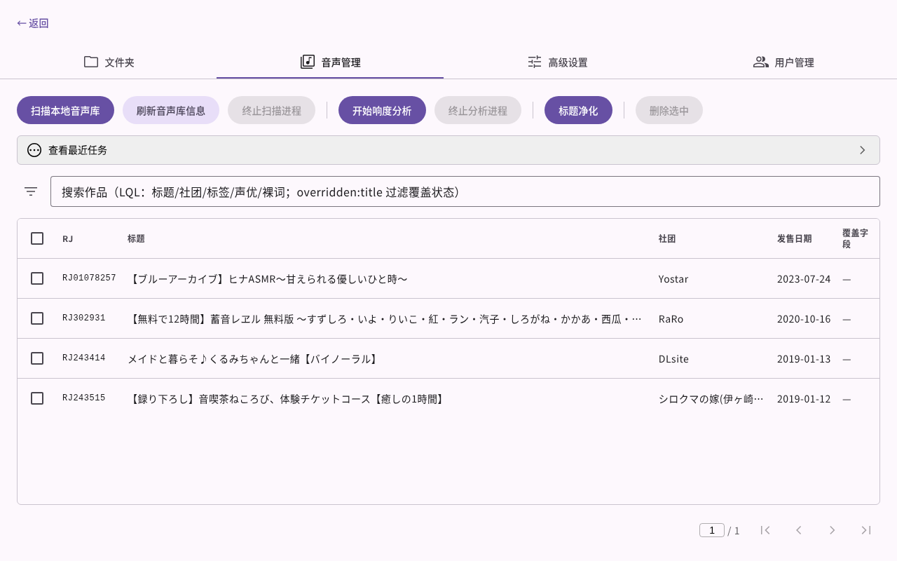
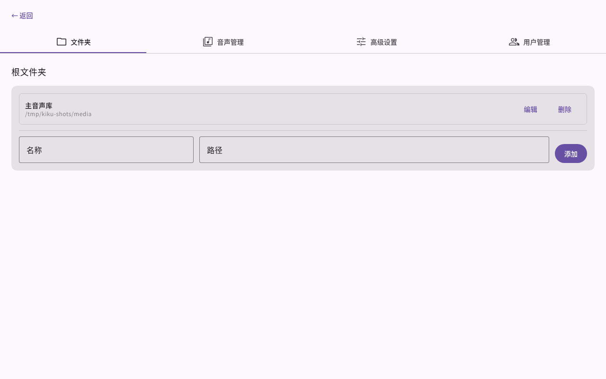
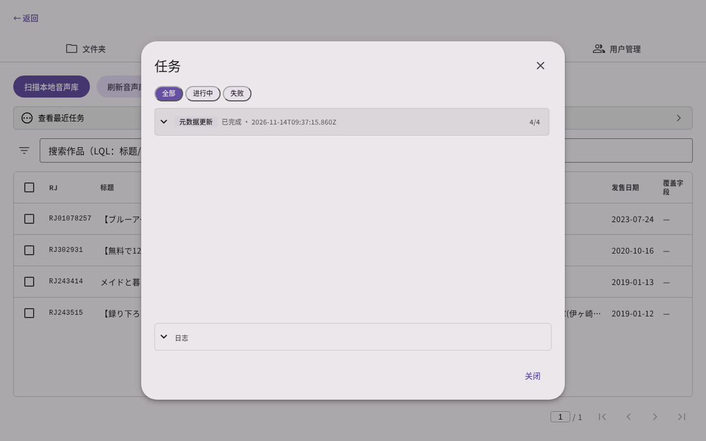
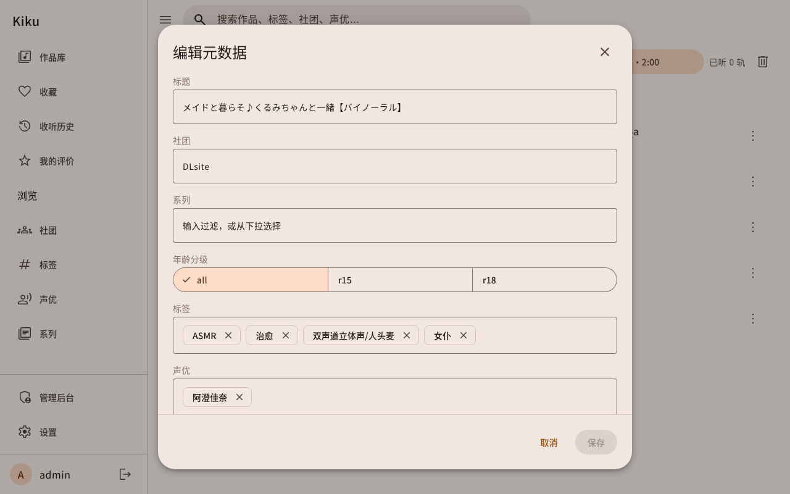
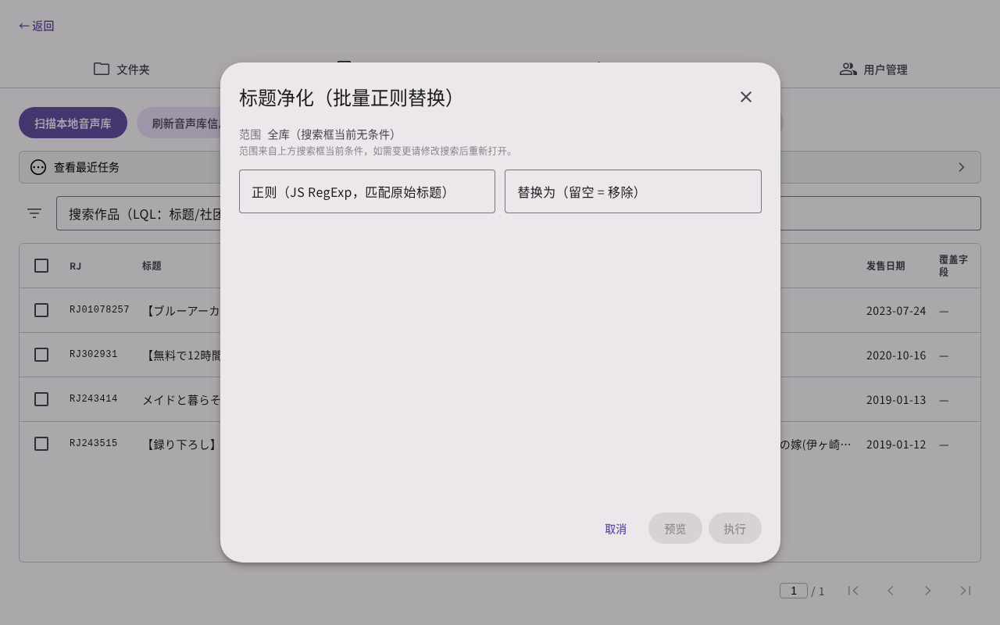
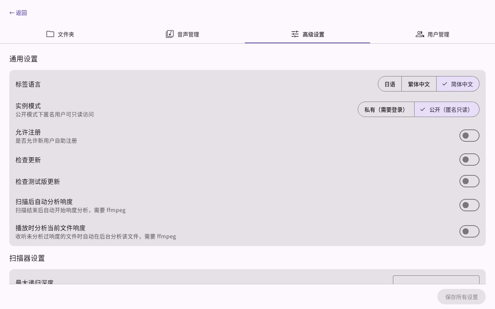

# Dashboard

The dashboard is the admin-only management area. In private mode, sign in with an admin account and open it from the side navigation; in public mode it remains admin-only as well.

## Overview

The dashboard has four sections:



- **Audio management**: the work list, scanning and metadata refresh, loudness analysis, soft delete
- **Folders**: media library root folder management
- **Server settings**: instance mode, registration, tag language, scanner, network, and more
- **User management**: accounts and permissions

## Root Folders

Root folders are where scanning starts: kiku discovers voice works under each root folder and imports them into the library.



- **Add**: enter a name (e.g. "Main library") and a path. In Docker deployments use a subdirectory under `/media` (e.g. `/media/library`); when running from source, use an absolute path on the host
- **Edit**: change the name or path
- **Delete**: removes only the scan configuration — works already imported stay in the library

Multiple root folders can be added; a scan covers them all.

## Scanning

### Scan Local Library

Scans the files on disk under the root folders, discovers new works and imports them. Run this after adding new files — incremental updates are supported.

#### Work Layouts

Code rule: a prefix plus 6 or 8 digits, case-insensitive (e.g. `RJ123456`, `VJ08123456`). The code can appear anywhere in a directory or file name at any depth under a root folder (the scan depth is adjustable in the scanner options under [Server Settings](#server-settings)); directories recognized as works are not descended into. Three work layouts are supported:

- **Folder works**: a folder named after the code (e.g. `RJ123456/`) — the most common layout
- **Archive works**: a `.zip` or `.tar` file named after the code (e.g. `RJ123456.zip`). They play without extraction: kiku reads inside the archive on demand with random access, so playback feels identical to folder works. Only uncompressed layouts are supported — the zip must use "stored" mode; deflate zips, 7z, rar and gzip are rejected at scan time with a repack hint:

  ```bash
  # repack as a stored (uncompressed) zip: -mx=0 means no compression
  7z a -mx=0 RJ123456.zip RJ123456/
  # or pack as an uncompressed tar
  tar cf RJ123456.tar RJ123456/
  ```

- **Manual works**: works whose prefix is not RJ / VJ but a built-in manual prefix (currently `UW`), e.g. `UW123456/`. They are not scraped from DLsite; during scanning the cover is imported from the work folder (prefers `cover.jpg`, then `folder.jpg`; jpg / jpeg / png / webp). Cards and the detail page show no DLsite link, and "Refresh metadata" is not offered for them

### Refresh Metadata

Re-scrapes work metadata from DLsite:

- **Refresh everything**: re-scrapes every work in the library; this takes a while and asks for confirmation first
- **Refresh selection**: tick works in audio management and refresh just those

The refresh runs as a background task (see [Task Center](#task-center)); other operations can continue while it runs. Useful when a DLsite page has changed (new tags, updated ratings) or when an earlier scrape was incomplete.

### Task Center

Scanning, metadata refresh and loudness analysis all run as background tasks: they keep running across page navigation, and progress streams to every open page in real time.

While tasks exist, the audio management page shows a task entry with the overall progress of running batches (once everything finishes it becomes a "recent tasks" entry). Open it to see the task center:



- **Batch cards**: one card per run — scan, metadata update or loudness analysis — with status, overall progress and per-work phase dots (including failure reasons); running batches start expanded
- **Logs**: the log panel at the bottom collects task logs, timestamps shown in the browser's timezone; collapsible
- **Filters**: show all batches, only active ones, or only failed ones
- **Cancel**: stop an entire batch, or just a single work's pipeline

"Terminate scan" on the audio management page aborts the running scan. Finished batches stay viewable for about five minutes before being cleaned up. Admin operations on a work's detail page (refresh metadata, sync tracks, loudness analysis) are queued as tasks the same way — while a work is being processed, its menu items are disabled and a phase indicator shows progress.

## DLsite Metadata

When a work is imported, the following information is scraped from DLsite: title, cover, circle, voice actors, tags, series, rating, release date and age rating (R18 / R15 / all-ages).

### Managing Metadata

The audio management page can search works by title, circle, tag or voice actor, and offers quick filters:

- **Overridden info**: works whose metadata was edited manually
- **unknown circles**: works whose circle could not be identified
- **R18 / R15 / all-ages**: filter by age rating

On a work's detail page, "Edit metadata" overrides any field manually (title, circle, series, tags, …). Overridden fields are marked as differing from the original DLsite data, which makes them easy to audit later.



### Title Sanitization



Many voice works ship with file names carrying shared prefixes or suffixes (circle names, kana decorations), which makes imported titles messy. Title sanitization applies regex replacements in bulk: configure rules, apply them across the library, and the rewritten titles are marked as overridden just like manual edits.

### Updating Track Durations

Track durations can go stale after files change. "Update track durations" on a single work re-reads the actual durations from the audio files on disk.

## Loudness Analysis

Loudness analysis measures each work's overall loudness. It is the data source for the player's volume normalization (see [Player · Volume Normalization](playback.md#volume-normalization)).

- **Batch analysis**: analyze every unanalyzed work in the library, or only the selected ones; tracks that already have loudness data are skipped
- **Automatic analysis**: can be enabled under [Server Settings](#server-settings) to analyze newly imported works after each scan
- **Analysis details**: analysis runs as a background task — follow progress and results live in the [task center](#task-center)
- **Loudness curve**: a work's detail page can display its loudness curve

Analysis runs on the server and requires `ffmpeg` (bundled in the Docker image).

## Soft Delete

Tick one or more works in audio management and delete them. Deletion is a **soft delete**: the work disappears from all lists immediately; as long as the files remain on disk, the next scan brings it back. Removing files for good is done in the file system.

## Server Settings



- **Instance mode**: private (login required) / public (anonymous read-only browsing) — the same choice offered by the setup wizard, changeable any time
- **Allow registration**: whether new users can sign up on their own
- **Tag language**: the language DLsite tags are scraped in — Japanese / Traditional Chinese / Simplified Chinese
- **Scanner settings**: options controlling scanning behavior
- **Max parallelism**: how many scan / task workers run concurrently; changes take effect immediately, no restart needed
- **Network / proxy**: proxy configuration for outbound requests
- **Check for updates**: check for stable and beta releases

## User Management

Manage registered users: view the user list, adjust permissions and reset passwords. Self-registered users start with regular permissions, adjusted by the admin as needed.
