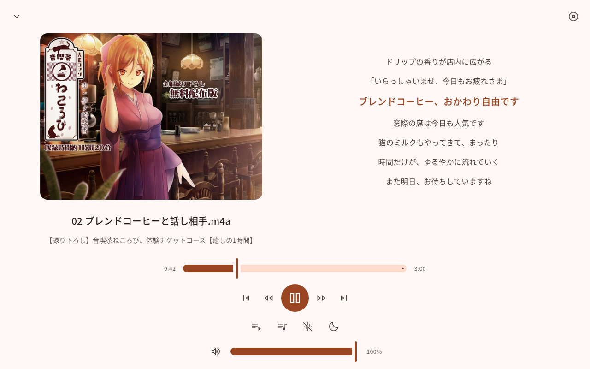
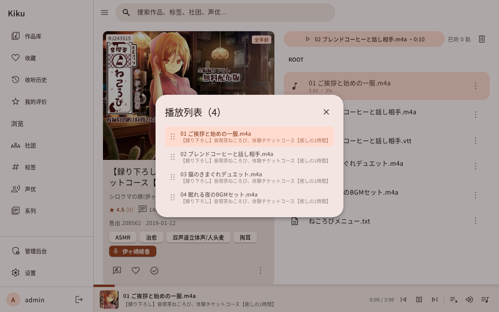
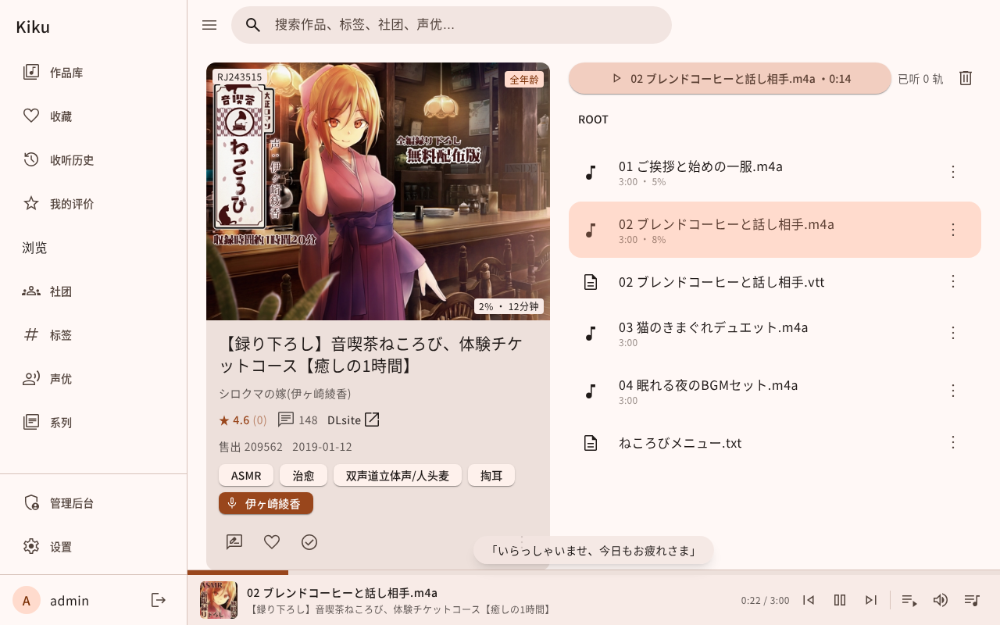
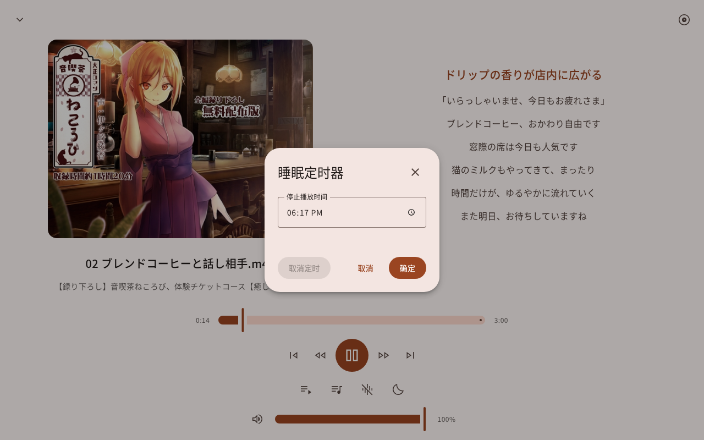

# Player

This chapter covers kiku's playback features: basic controls, the play queue, video playback, lyrics, the sleep timer and volume normalization.

## Player Layout

While playing, a player bar appears at the bottom of the screen showing the current track, playback controls and progress:

The player bar stays at the bottom of the screen; switching pages never interrupts playback. Expand it to see the large cover, lyrics and queue, and to jump to the current work's detail page:

The fullscreen player's cover is shown 1:1 by default; the cover's original aspect ratio is available in [Settings · Player Preferences](settings.md#player-preferences).

## Basic Controls

- Play / pause
- Previous / next track
- Rewind / forward (step length adjustable in [Settings · Player Preferences](settings.md#player-preferences))
- Progress bar scrubbing
- Volume (with percentage readout) and mute

## Play Queue

The queue is the upcoming play list. From a work's detail page, queue a whole work or a single file:

- **Add to queue**: append to the end of the queue
- **Play next**: insert right after the current track

## Play Modes

Four modes, switchable in the player at any time:

- **In order**: play through the queue once, then stop
- **Repeat all**: wrap around to the start when the queue ends
- **Repeat one**: repeat the current track
- **Shuffle**: pick tracks from the queue at random

## Video Playback

Works can contain video files (`.mp4`, `.webm`, `.mkv`). They appear in the work's track list just like audio tracks and play in the normal queue: in the expanded player the picture replaces the cover, and tapping the picture pauses / resumes playback. If the browser cannot decode a format (e.g. many `.mkv` files), kiku falls back to the cover image with a hint to download the file from the menu.

How video files are handled is controlled by **Settings · Player Preferences · Video playback**:

- **Video**: play with picture
- **Audio only**: play the video's audio track without the picture
- **Off**: video files are excluded from the queue entirely

## Lyrics

### Lyrics Panel

Expand the player to view the current track's lyrics, highlighted and scrolling with playback. Lyrics files named after their track — including double extensions like `track.wav.vtt` — are picked up automatically.

### Floating Lyrics

When enabled, the current lyric line floats above the player bar, no need to expand the player. Styling is adjustable in [Settings · Player Preferences](settings.md#player-preferences): font size, line limit (long lines wrap, overflow is omitted) and background opacity.

## Sleep Timer

Set a time when playback should stop; it pauses automatically.

## System Media Controls

When enabled, the system's media panel and lock screen show playback controls, and keyboard media keys (play/pause, previous, next) work as well. Toggle it in [Settings · Player Preferences](settings.md#player-preferences).

## Volume Normalization

Recordings differ widely in loudness. With volume normalization on, playback is leveled automatically using each work's loudness data, so there is no need to reach for the volume control when switching works.

- **Prerequisite**: the server has run [loudness analysis](library.md#loudness-analysis); unanalyzed works play at their original volume
- **Target loudness**: the loudness (LUFS) everything is leveled to, default -28 — higher is louder
- **Max gain**: caps the adjustment applied to a single work (±dB), default 12, so a very quiet work isn't boosted into distortion

Both are adjustable in [Settings · Player Preferences](settings.md#player-preferences).

## WavPack Support

WavPack (`.wv`) tracks play directly, no transcoding needed.
