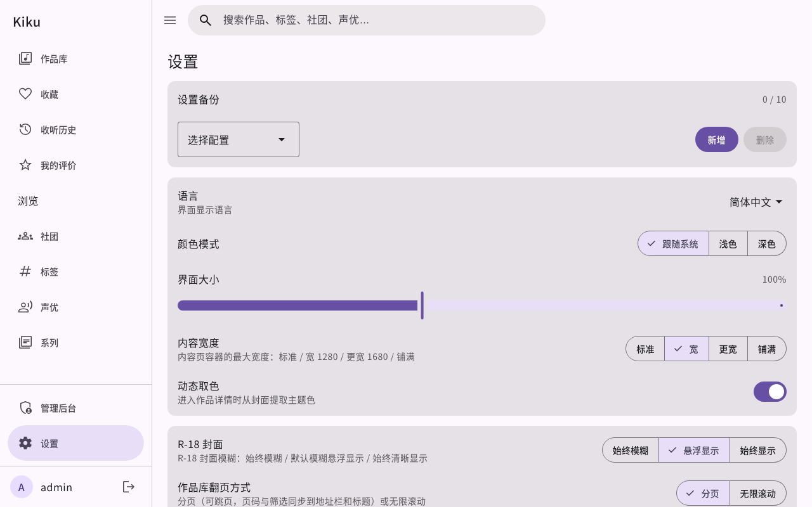
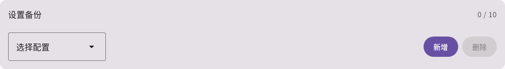

# Settings

The settings page controls per-user display and playback preferences. Most settings are stored in the local browser; when signed in, "Settings Backup" carries them across devices.

## General

| Option | Description |
| --- | --- |
| Language | UI language: English / 简体中文 |
| Color mode | Light / Dark / Follow system |
| Dynamic color | Extract a theme color from a work's cover when entering its detail page |
| UI scale | Overall interface scaling |
| Content width | Max width of the content container: Standard / Wide 1280 / Ultra 1680 / Full |

## Library Preferences

| Option | Description |
| --- | --- |
| Pagination mode | Pagination (jump to any page, state in the address bar) or infinite scroll |
| Paginator position | Top / Bottom / Top and bottom |
| Page size | Works shown per page in the library and listen history: 10 / 20 / 50 / 100 |
| Recent listens | Show a recent-listens strip at the top of the library home |

## R-18 Cover Blur

Controls how R-18 covers are displayed:

- **Always blur**: covers stay blurred in listings
- **Blur until hover**: blurred by default, shown on hover
- **Never blur**: shown as-is

## Player Preferences

| Option | Description |
| --- | --- |
| Time display | Show total duration (22:33) or remaining time (-1:39) in the player |
| Rewind seconds / Forward seconds | Step length of the rewind and forward buttons |
| Media notification | Show playback controls in the system media panel / lock screen |
| Video playback | How video files inside works are played: with picture / audio only / excluded from the queue — see [Player · Video Playback](playback.md#video-playback) |
| Cover aspect ratio | Fullscreen player cover: 1:1 crop or original ratio |
| Volume normalization | Level volume using per-work loudness data — see [Player · Volume Normalization](playback.md#volume-normalization) |
| Target loudness | The normalization target (LUFS), default -28 |
| Max gain | Cap of the adjustment applied to a single work (±dB), default 12 |
| Floating lyrics | Toggle and styling: font size (default 14px), line limit, background opacity (0.2–1) |

## Settings Backup

Save all personal settings as a named snapshot and restore it anytime — after switching devices or reinstalling the browser, sign in and restore. Signing in is required:

- **Add backup**: name and save the current settings
- **Restore**: apply a snapshot back to the current settings
- **Delete**: remove unneeded snapshots

## Account

- **Sign in**: in private mode every visit requires signing in; in public mode signing in unlocks favourites, ratings, history and other personal features
- **Register**: when the instance allows it, an account can be created from the login page (new accounts start with regular permissions)

Instance mode and the registration switch are controlled by the admin in [Server Settings](library.md#server-settings).

## Version Info

The bottom of the settings page shows the frontend and server versions as `<release tag>-<short hash>` (e.g. `v1.2.0-a1b2c3d`), for confirming what's deployed and for bug reports.
