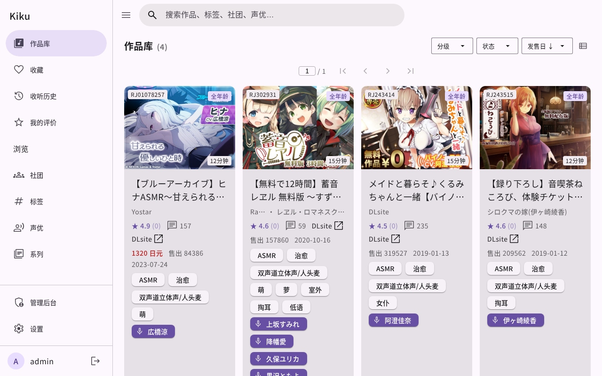
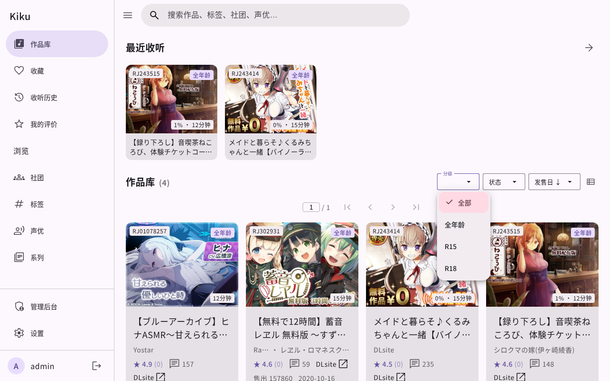
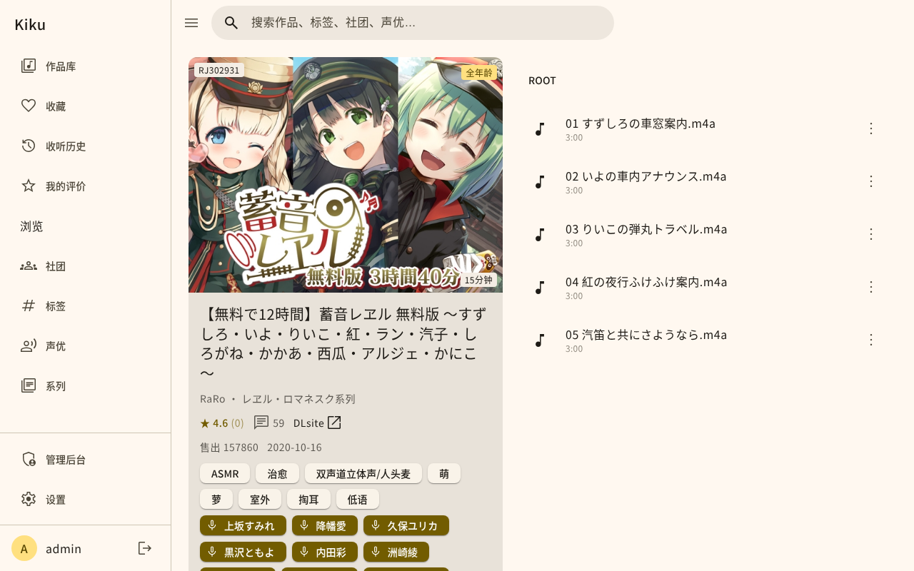
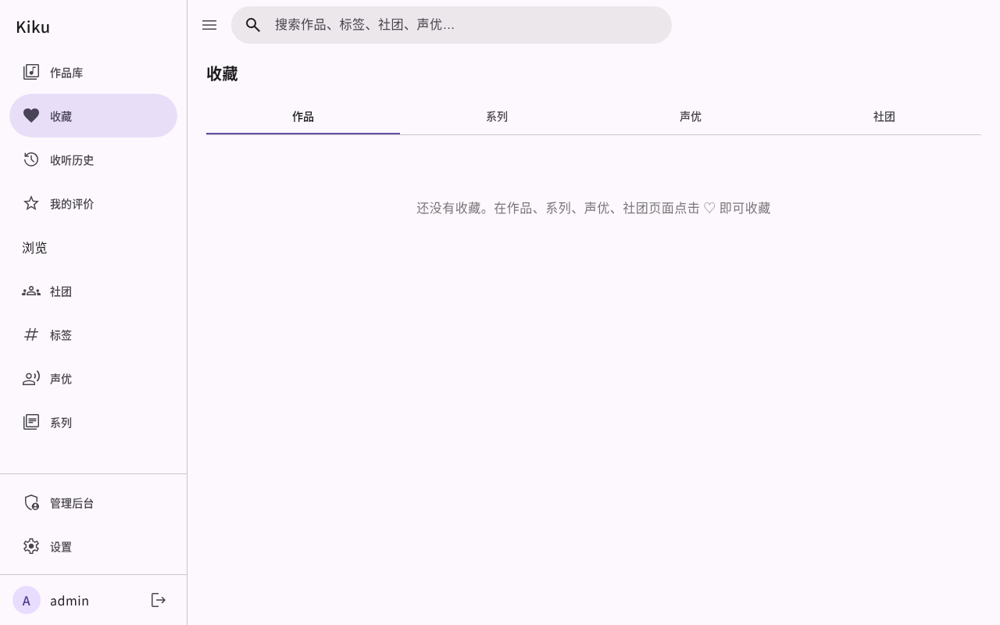

# 浏览与个人数据

本章介绍日常使用：搜索作品、管理收藏、评分评价，以及 kiku 记录的各类进度与历史。

## 作品库

作品库是浏览的主界面，支持网格与列表两种视图（可切换）：

开启「最近收听」后，作品库首页顶部会显示最近收听的作品条。

## 搜索与筛选

- **关键词搜索**：顶部的全局搜索栏按关键词匹配作品；也支持字段语法精确过滤，如 `circle:"社团名"`、`tag:"标签"`、`va:"声优"`、`series:"系列名"`（在详情页点击对应 chip 会生成同样的查询）
- **字段筛选**：可按社团、标签、声优、系列分别浏览与筛选，多个条件可组合使用

筛选条件会同步到浏览器地址栏，可以直接收藏或分享带筛选状态的链接。

## 排序

作品库支持以下排序方式：

- 发售日期（新→老 / 老→新）
- RJ 号（大→小 / 小→大）
- 随机
- 更好的随机

## 浏览方式

两种翻页方式（在[个人设置](settings.md#作品库偏好)中切换）：

- **分页**：可跳页，页码与筛选状态同步到地址栏
- **无限滚动**：向下滚动自动加载

分页模式下可调整每页数量（10 / 20 / 50 / 100，默认 20）与分页控件位置（顶部 / 底部 / 顶部和底部）。

## 作品详情页

详情页展示作品的完整信息：封面、标题、社团、声优、标签、系列、评分、发售日期、年龄分级等，下方是作品的文件树。人工编号的作品（见[管理后台 · 作品形态](library.md#作品形态)）没有 DLsite 页面，不显示 DLsite 链接。

- **继续播放**：再次进入曾听过的作品时，可从上次的位置继续
- **文件预览**：预览图片与文本文件（歌词、说明文本等）
- **下载**：下载单个文件
- **文件操作**：添加到队列、下一首播放、打开文件、查看响度曲线

## 收藏

作品、系列、声优、社团四类对象均可收藏，收藏页按类别查看。收藏需要登录后使用。

## 评分与评价

在作品详情页可打星评分并写下短评；评分与短评会汇总在「我的评价」列表中。评价需要登录后使用。

## 已读与未读

播放过的作品会自动标记为已读，也可手动标记已读或未读。

## 收听历史

播放记录按时间排列，可在收听历史页查看与翻页（侧边导航抽屉中也有入口），每条记录均显示上次播放到的位置。收听历史需要登录后使用。
