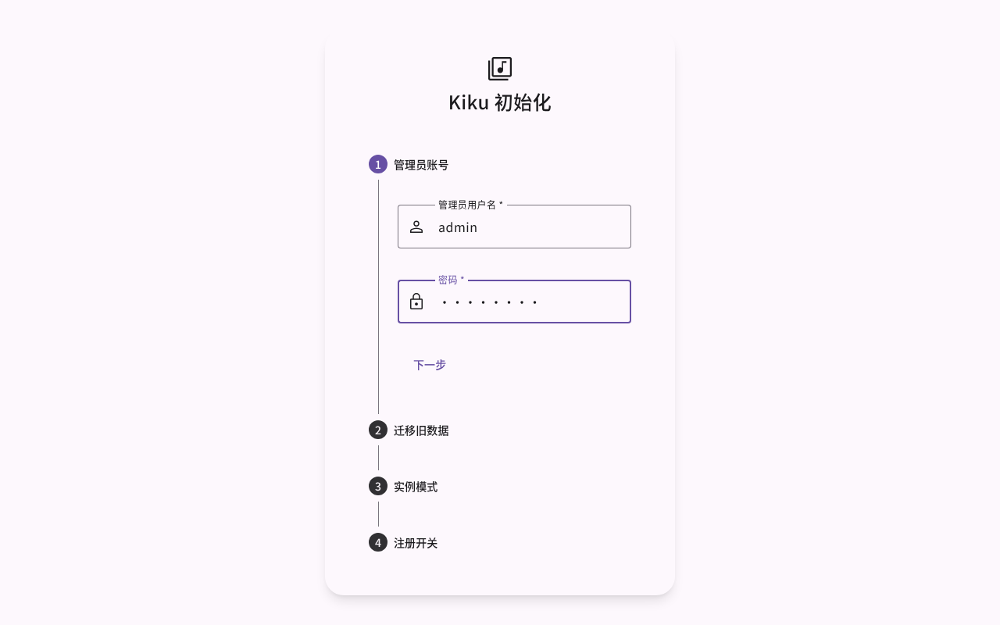
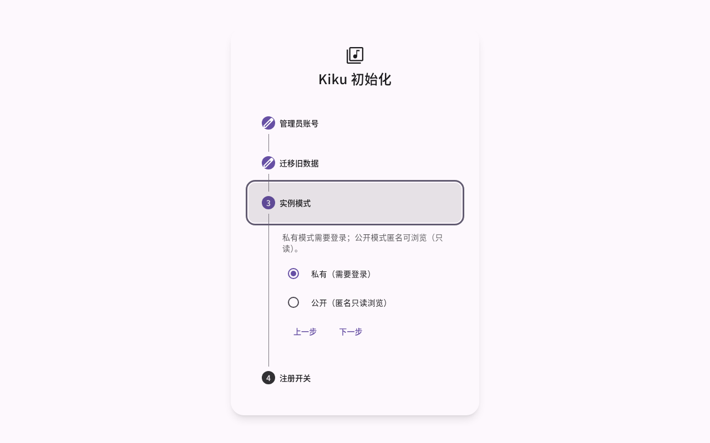

# 安装部署

本章介绍如何部署 kiku 并完成首次初始化：使用 Docker Compose（推荐）或从源码运行。

## 系统要求

- **Docker 部署（推荐）**：Docker Engine 与 Docker Compose v2
- **源码运行**：[Bun](https://bun.sh) 1.x
- 浏览器：现代浏览器的较新版本（Chrome / Edge / Firefox / Safari）
- 网络：服务器需能访问 DLsite，用于抓取作品元数据与封面

## Docker Compose 部署（推荐）

无需克隆仓库：新建一个目录（如 `kiku`）存放配置与数据，在其中创建 `compose.yml`，内容如下：

```yaml
services:
  kiku:
    image: ghcr.io/sion10032/kiku:latest
    restart: always
    ports:
      - "8888:8888"
    environment:
      HOST: 0.0.0.0
      PORT: 8888
      PUID: ${PUID:-1000}
      PGID: ${PGID:-1000}
    volumes:
      - ./data:/app/data
      - ${MEDIA_DIR:-./data/library}:/media:ro
```

然后在该目录执行：

```bash
docker compose up -d
```

使用预构建镜像 `ghcr.io/sion10032/kiku:latest`，监听 `8888` 端口，启动后访问 `http://<host>:8888`。

### 环境变量

可在 `compose.yml` 或同级 `.env` 文件中调整：

| 变量 | 默认值 | 说明 |
| --- | --- | --- |
| `HOST` | `0.0.0.0` | 服务监听地址 |
| `PORT` | `8888` | 服务监听端口 |
| `PUID` | `1000` | 数据目录属主的用户 uid |
| `PGID` | `1000` | 数据目录属主的组 gid |
| `MEDIA_DIR` | `./data/library` | 媒体库根目录（宿主机路径），容器内只读挂载到 `/media` |

`PUID` / `PGID` 建议设为宿主机运行用户的 uid / gid，使数据目录属主与之一致。

### 数据目录

| 宿主机路径 | 容器内路径 | 内容 |
| --- | --- | --- |
| `./data` | `/app/data` | `config.json`（首次启动自动生成）与 `sqlite/` 数据库 |
| `${MEDIA_DIR}`（默认 `./data/library`） | `/media`（只读） | 音声作品文件 |

媒体目录以**只读**方式挂载：kiku 不写入媒体文件，扫描、元数据、播放进度等数据全部存放在 `./data` 中。备份 `./data` 目录即备份全部服务器数据。

首次启动会自动生成 `config.json`，无需手工准备。

如果你此前在开发目录运行过后端，可将现有数据迁移到 Docker 数据目录：

```bash
cp -a kiku-backend/data/. ./data/
```

## 源码运行

适合开发或不想使用 Docker 的场景：

```bash
# 1. 启动后端（监听 8888）
cd kiku-backend
bun install
bun run dev

# 2. 另开一个终端，启动前端（监听 5173）
cd kiku-frontend
bun install
bun run dev
```

浏览器访问 `http://localhost:5173`。

也可以克隆仓库（包含前后端两个子模块）从源码构建 Docker 镜像，替代预构建镜像：

```bash
git submodule update --init
docker compose up -d --build
```

此时使用仓库自带的 `compose.yml`。

## 初始化向导

首次访问时，页面会引导你完成实例初始化（共 4 步）：



### 第 1 步：管理员账号

设置管理员用户名与密码。管理员可进入管理后台，进行扫描、元数据管理等操作。

### 第 2 步：迁移旧数据

向导会自动检测 `old-data` 目录中是否存在旧版 kikoeru 数据，并显示检测到的内容：作品数、用户数（含密码）、评论数、播放历史（将迁为已读标记）、封面数。

- 检测到旧数据且需要迁移：保持开关开启，完成初始化时一并迁移
- 全新安装：直接跳过（跳过后无法再自动迁移）

### 第 3 步：实例模式



- **私有（需要登录）**：所有访问均需登录，适合个人或小圈子使用
- **公开（匿名只读浏览）**：匿名用户可浏览作品库，登录后才有收藏、评分、历史等个人功能

之后可在管理后台的「服务器设置」中随时更改。

### 第 4 步：注册开关

选择是否允许用户自行注册账号。注册用户默认为普通权限，管理员可随时在后台调整。

确认无误后点击「完成初始化」。

## 从 kikoeru 迁移

如果你此前使用 kikoeru（kikoeru-express + kikoeru-quasar）或其 Number178 fork（kikoeru number17），可在初始化向导中自动迁移旧数据：

1. 将旧版数据目录（包含 `sqlite/db.sqlite3` 与 `covers/`）挂载或复制为容器内的 `old-data` 目录。Docker Compose 部署时，在 `compose.yml` 的卷列表中加入：

   ```yaml
   volumes:
     - ./old-data:/app/old-data:ro
   ```

2. 重新启动容器并访问页面，初始化向导会检测到旧数据
3. 保持「迁移旧数据」开关开启，点击「完成初始化」

迁移完成后，请到管理后台把根文件夹路径改为当前环境的实际路径（如 `/media/...`），再执行扫描。

## 升级

```bash
docker compose pull        # 拉取新镜像
docker compose up -d
```

升级时 `./data` 数据卷保持不动，配置、数据库、备份快照都会保留。升级前建议先复制一份 `./data` 目录作为备份。

## 常见问题

**容器启动后立即退出，日志出现 `EACCES: permission denied, open '/app/data/config.json'`**

数据目录属主与 `PUID` 不一致。容器启动时会自动尝试修正数据目录的属主；若仍出现此错误，请检查宿主机上 `./data` 的属主与挂载权限是否与 `PUID` / `PGID` 一致。

**页面无法访问**

检查端口映射（默认 `8888:8888`）与防火墙设置；服务健康状态可通过 `GET /api/health` 验证（私有模式下该路径也无需登录）。
