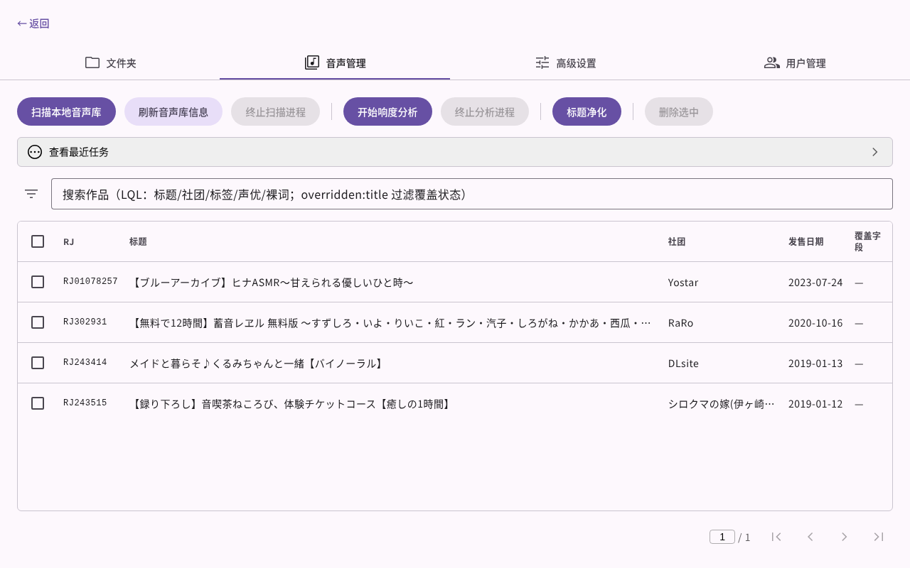
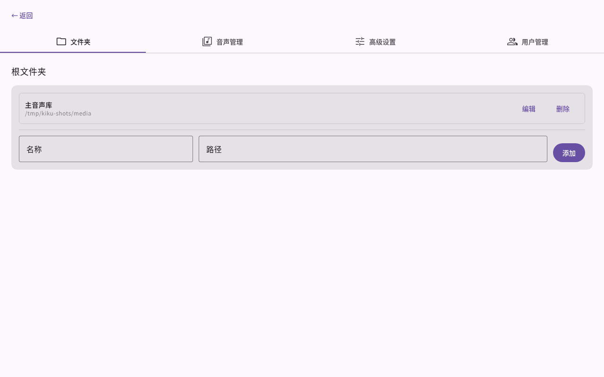
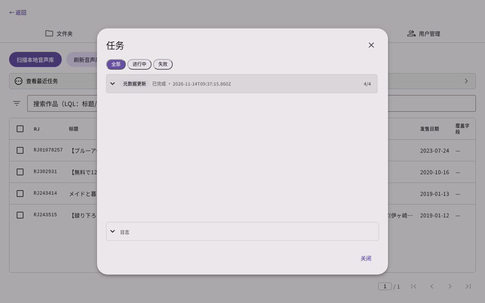
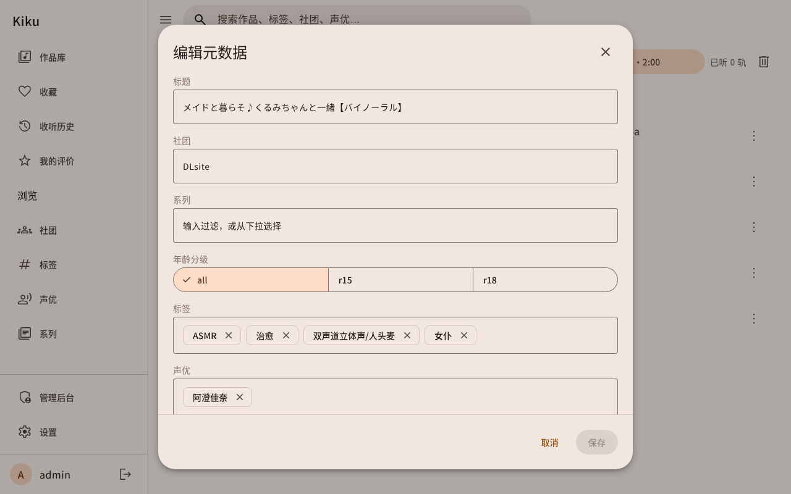
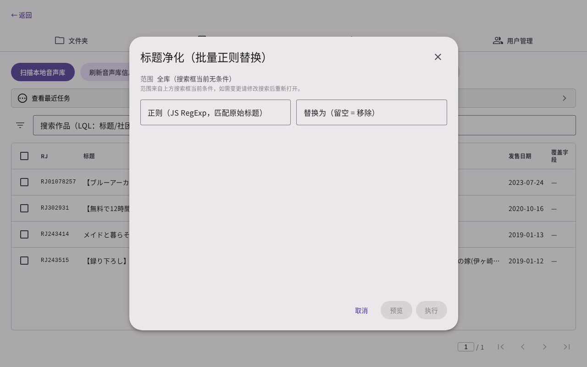
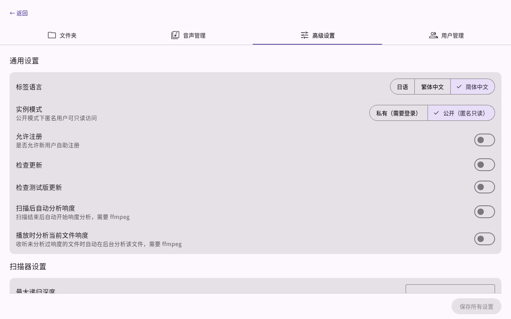

# 管理后台

管理后台是管理员专用的管理区域，私有模式下用管理员账号登录后，从侧边导航进入。公开模式下同样仅管理员可访问。

## 总览

管理后台分为四个区块：



- **音声管理**：作品列表、扫描与元数据刷新、响度分析、软删除
- **文件夹**：媒体库根文件夹管理
- **服务器设置**：实例模式、注册开关、标签语言、扫描器、网络等
- **用户管理**：账号与权限

## 根文件夹

根文件夹是扫描的起点：kiku 会在每个根文件夹下发现音声作品并入库。



- **添加**：填入名称（如「主音声库」）与路径。Docker 部署时路径填 `/media` 下的实际子目录（如 `/media/library`）；源码运行填宿主机绝对路径
- **编辑**：修改名称或路径
- **删除**：仅移除该根文件夹的扫描配置，已入库的作品记录不受影响

可添加多个根文件夹，扫描时一并处理。

## 扫描

### 扫描本地音声库

扫描根文件夹下的磁盘文件，发现新作品并入库，支持增量更新。日常添加新文件后执行即可。

#### 作品形态

编号规则：前缀 + 6 位或 8 位数字，不区分大小写（如 `RJ123456`、`VJ08123456`）。编号可出现在根文件夹下任意深度目录或文件名的任意位置（扫描深度可在[服务器设置](#服务器设置)的扫描器选项中调整），被识别为作品的目录内部不再下探。支持三种作品形态：

- **文件夹作品**：编号命名的文件夹（如 `RJ123456/`），最常见的形态
- **压缩包作品**：编号命名的 `.zip` 或 `.tar` 文件（如 `RJ123456.zip`）。无需解压即可播放：kiku 直接在包内按需随机读取，播放体验与文件夹作品完全一致。仅支持未压缩格式——zip 须为「仅存储（stored）」模式，deflate zip、7z、rar、gzip 等均不支持，扫描时会失败并提示重新打包：

  ```bash
  # 重新打包为仅存储的 zip（-mx=0 即不压缩）
  7z a -mx=0 RJ123456.zip RJ123456/
  # 或打包为未压缩的 tar
  tar cf RJ123456.tar RJ123456/
  ```

- **人工编号作品**：前缀不是 RJ / VJ，而是内置人工前缀（目前为 `UW`）的作品（如 `UW123456/`）。这类作品不从 DLsite 抓取元数据，扫描时从作品文件夹内自动导入封面（优先 `cover.jpg`，其次 `folder.jpg`，支持 jpg / jpeg / png / webp）；卡片与详情页不显示 DLsite 链接，管理菜单中也没有「刷新元数据」操作

### 刷新音声库信息

重新从 DLsite 抓取作品的元数据：

- **全库刷新**：对库内全部作品重新抓取，耗时较长，执行前会弹出确认
- **刷新选中**：在音声管理中勾选若干作品后仅刷新选中项

刷新会作为后台任务执行（见[任务中心](#任务中心)），执行期间可继续其他操作。适用于 DLsite 页面信息更新（如追加标签、评分变化）或初次抓取不完整的作品。

### 任务中心

扫描、元数据刷新与响度分析均以后台任务运行：切换到其他页面不影响执行，进度实时推送到所有已打开的页面。

有任务时，音声管理页会显示任务入口，展示进行中批次的总进度（全部结束后变为「查看最近任务」入口）。打开即为任务中心：



- **批次卡片**：每次运行一张卡片——扫描、元数据更新或响度分析——显示状态、总进度与各作品的阶段点（含失败原因）；运行中的批次默认展开
- **日志**：底部日志面板汇总任务日志，时间戳按浏览器时区显示；可折叠
- **筛选**：可只看全部 / 进行中 / 失败的批次
- **取消**：可取消整个批次或单个作品的处理

「终止扫描进程」按钮用于中断正在运行的扫描。已结束的批次会保留约五分钟供查看，之后自动清理。作品详情页的管理操作（刷新元数据、同步音轨、响度分析）同样以任务方式排队执行——作品处理期间菜单项会禁用，并以阶段指示器显示进度。

## DLsite 元数据

入库时会从 DLsite 抓取以下信息：标题、封面、社团、声优、标签、系列、评分、发售日期、年龄分级（R18 / R15 / 全年龄）。

### 元数据管理

音声管理页提供按标题、社团、标签、声优搜索作品的能力，以及一组快捷筛选：

- **已修改的信息**：被手动编辑过元数据的作品
- **unknown 社团**：未能识别社团的作品
- **R18 / R15 / 全年龄**：按年龄分级筛选

在作品详情页可通过「编辑元数据」手动覆盖任意字段（标题、社团、系列、标签等）；被覆盖的字段会标记为与 DLsite 原始数据不同，便于日后排查。



### 标题净化



很多音声作品的文件名带有统一的前后缀（如社团名、假名缀），入库后标题杂乱。「标题净化」提供批量正则替换：配置规则后对库内标题批量应用，结果同样标记为已覆盖。

### 更新音轨时长

作品的音轨时长信息在文件变化后可能过期。对单个作品使用「更新音轨时长」可重新读取磁盘上音频文件的实际时长。

## 响度分析

响度分析测量每部作品的整体响度，是播放器「音量均衡」功能的数据来源（参见[播放器 · 音量均衡](playback.md#音量均衡)）。

- **批量分析**：可对库内全部未分析的作品，或仅选中的作品执行分析；已有响度数据的音轨会自动跳过
- **自动分析**：可在[服务器设置](#服务器设置)中开启，每次扫描完成后自动分析新入库的作品
- **分析详情**：分析以后台任务运行，可在[任务中心](#任务中心)实时查看进度与结果
- **响度曲线**：作品详情页可查看单个作品的响度曲线

分析在服务器端进行，需要服务器安装 `ffmpeg`（Docker 镜像已内置）。

## 软删除

在音声管理中勾选一个或多个作品后可执行删除。删除是**软删除**：作品立即从所有列表中隐藏；只要磁盘上的文件还在，重新扫描时即恢复。真正删除文件需自行在文件系统中操作。

## 服务器设置



- **实例模式**：私有（需要登录）/ 公开（匿名只读浏览），与初始化向导中的选择等效，可随时更改
- **允许注册**：是否允许新用户自助注册
- **标签语言**：DLsite 标签抓取语言，可选日语 / 繁体中文 / 简体中文
- **扫描器设置**：扫描行为的相关选项
- **最大并行数**：扫描等并发任务的工作线程数；修改后立即生效，无需重启
- **网络 / 代理**：出站请求的代理配置
- **检查更新**：检查正式版与测试版更新

## 用户管理

管理注册用户：查看用户列表、调整用户权限、重置用户密码。自助注册的用户默认为普通权限，由管理员按需调整。
