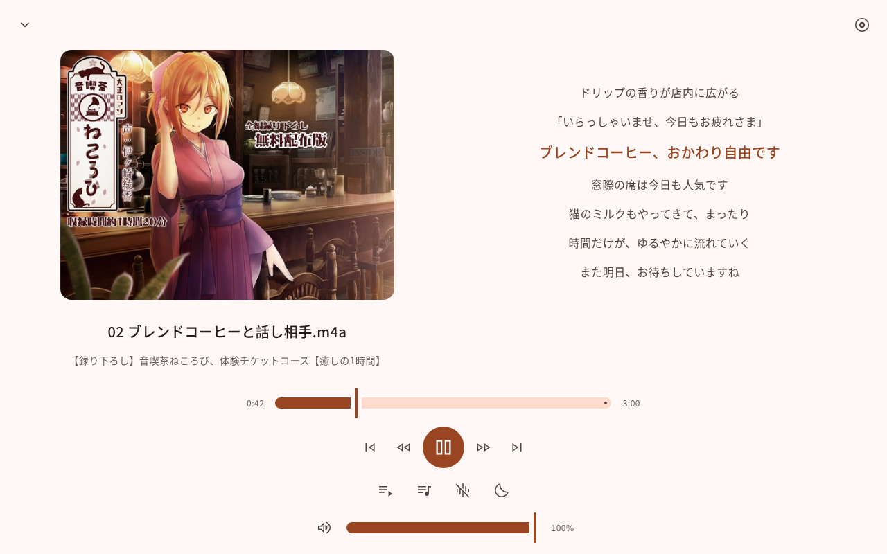
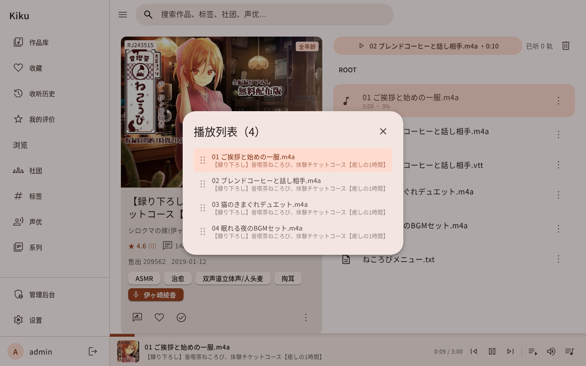
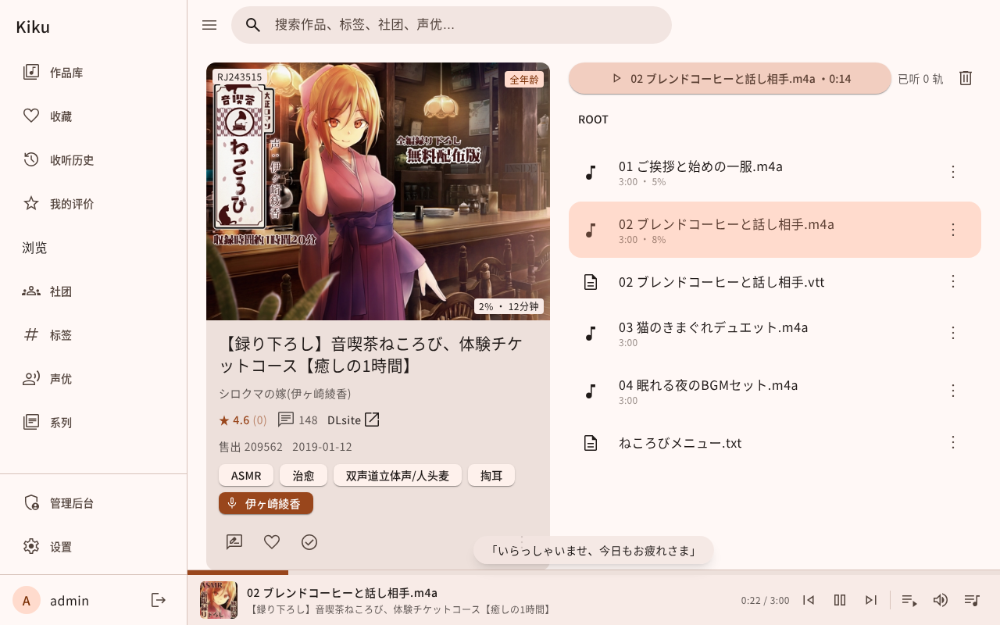
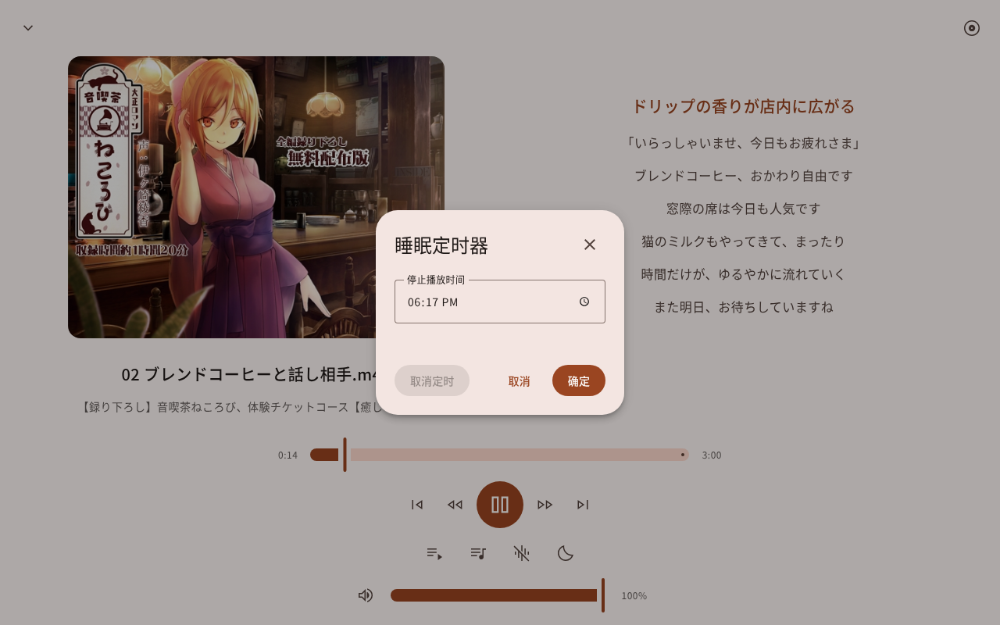

# 播放器

本章介绍 kiku 的播放功能：基本控制、播放队列、视频播放、歌词、睡眠定时器与音量均衡。

## 播放器布局

播放时屏幕底部会出现播放条，显示当前音轨、播放控制与进度：

播放条常驻屏幕底部，切换页面不中断播放。展开播放器后可查看大封面、歌词与队列，并可直达当前作品详情页：

全屏播放器的封面默认按 1:1 显示；可在[个人设置](settings.md#播放器偏好)中改为按封面原始比例显示。

## 基本控制

- 播放 / 暂停
- 上一首 / 下一首
- 快退 / 快进（步长可在[个人设置](settings.md#播放器偏好)中调整）
- 进度条拖动定位
- 音量调节（显示百分比）与静音

## 播放队列

队列是当前的待播列表。在作品详情页可对整个作品或单个文件执行：

- **添加到队列**：追加到队列末尾
- **下一首播放**：插到当前音轨之后

## 播放模式

四种模式，在播放器中随时切换：

- **顺序播放**：按队列顺序播完即停
- **列表循环**：队列播完回到开头
- **单曲循环**：重复当前音轨
- **随机播放**：在队列中随机选曲

## 视频播放

作品内可以包含视频文件（`.mp4`、`.webm`、`.mkv`），与音轨一样出现在文件列表中并进入播放队列：展开播放器后画面取代封面的位置，点击画面可暂停 / 继续。浏览器无法解码的格式（如多数 `.mkv`）会回退为封面图，并提示可通过菜单下载文件。

视频文件的处理方式由**个人设置 · 播放器偏好 · 视频播放**控制：

- **视频**：带画面播放
- **仅音频**：只播视频中的音轨，不显示画面
- **无**：视频文件完全不进入队列

## 歌词

### 歌词面板

展开播放器可查看当前音轨的歌词，随播放进度高亮滚动。与音轨同名的歌词文件（包括 `track.wav.vtt` 这类双扩展名）会被自动识别。

### 悬浮歌词

开启后，当前歌词悬浮显示在播放条上方，无需展开播放器。样式可在[个人设置](settings.md#播放器偏好)中调整：字体大小、行数上限（过长时换行省略）与背景透明度。

## 睡眠定时器

设定一个停止播放的时间，到点自动暂停。

## 系统媒体控制

开启后，系统的媒体面板与锁屏界面会显示播放控制，键盘媒体键（播放/暂停、上一首、下一首）同样可控。可在[个人设置](settings.md#播放器偏好)中开关。

## 音量均衡

不同作品的录音响度差异很大。开启音量均衡后，播放时按各作品的响度数据自动统一音量，切换作品时无需手动调整音量。

- **前提**：服务器已完成[响度分析](library.md#响度分析)，未分析的作品按原始音量播放
- **目标响度**：所有作品统一调整到的响度（LUFS），默认 -28，数值越大越响
- **最大增益**：限制对单个作品施加的调整幅度（±dB），默认 12，避免过安静的作品被拉得过响

参数在[个人设置](settings.md#播放器偏好)中调整。

## WavPack 支持

WavPack（`.wv`）格式的音轨可以直接播放，无需转码。
