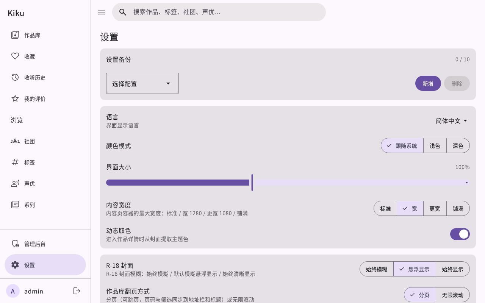
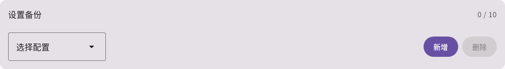

# 个人设置

设置页调整与用户相关的显示与播放偏好。多数设置保存在本地浏览器中，登录后可通过「设置备份」在设备间迁移。

## 通用

| 选项 | 说明 |
| --- | --- |
| 语言 | 界面显示语言：简体中文 / English |
| 颜色模式 | 浅色 / 深色 / 跟随系统 |
| 动态取色 | 进入作品详情时从封面提取主题色 |
| 界面大小 | 整体 UI 缩放 |
| 内容宽度 | 内容页容器的最大宽度：标准 / 宽 1280 / 更宽 1680 / 铺满 |

## 作品库偏好

| 选项 | 说明 |
| --- | --- |
| 翻页方式 | 分页（可跳页，状态同步地址栏）或无限滚动 |
| 分页控件位置 | 顶部 / 底部 / 顶部和底部 |
| 每页数量 | 作品库与收听历史每页显示数：10 / 20 / 50 / 100 |
| 最近收听 | 在作品库首页顶部显示最近收听条 |

## R-18 封面模糊

控制 R-18 作品封面的显示策略：

- **始终模糊**：列表中始终模糊显示
- **悬浮显示**：默认模糊，鼠标悬浮时显示
- **始终显示**：不模糊

## 播放器偏好

| 选项 | 说明 |
| --- | --- |
| 时间显示 | 播放器显示总时长（22:33）或剩余时间（-1:39） |
| 快退秒数 / 快进秒数 | 快退、快进按钮的步长（秒） |
| 媒体通知 | 系统媒体面板 / 锁屏显示播放控制 |
| 视频播放 | 作品内视频文件的播放方式：视频画面 / 仅播音轨 / 不入队，见[播放器 · 视频播放](playback.md#视频播放) |
| 封面比例 | 全屏播放器封面：1:1 裁剪或原始比例 |
| 音量均衡 | 按作品响度数据统一音量，见[播放器 · 音量均衡](playback.md#音量均衡) |
| 目标响度 | 均衡目标（LUFS），默认 -28 |
| 最大增益 | 单作品调整幅度上限（±dB），默认 12 |
| 悬浮歌词 | 开关与样式：字体大小（默认 14px）、行数上限、背景透明度（0.2–1） |

## 设置备份

把当前的全部个人设置保存为命名快照，随时还原；换设备或重装浏览器后，登录即可恢复。登录后可用：

- **新增备份**：为当前设置命名并保存
- **还原**：把某个快照应用回当前设置
- **删除**：移除不需要的快照

## 账户

- **登录**：私有模式下所有访问均需登录；公开模式下登录后可使用收藏、评分、历史等个人功能
- **注册**：实例允许注册时，可在登录页自行注册账号（注册用户默认普通权限）

实例模式与注册开关由管理员在[服务器设置](library.md#服务器设置)中控制。

## 版本信息

设置页底部显示前端与服务端版本，格式 `<发布的 tag>-<短 hash>`（如 `v1.2.0-a1b2c3d`），用于确认部署的版本与报告问题。
